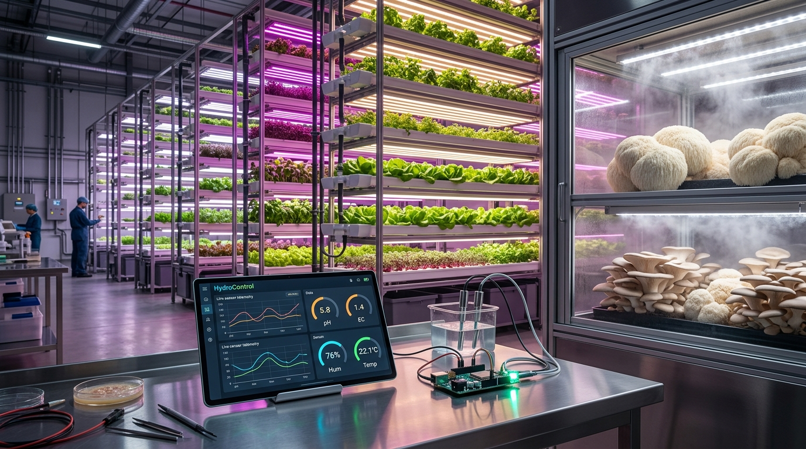
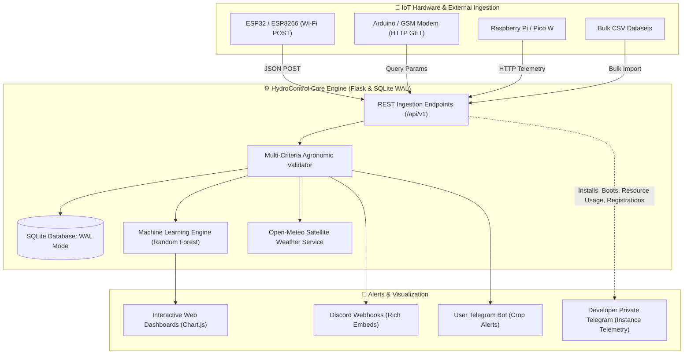

# 🌱 HydroControl - Comprehensive Control, AI & Telemetry System for Hydroponics

<p align="center">
  🌍 <strong>Language / Idioma / Langue:</strong><br>
  <a href="README.md"></a>
  <a href="README.en.md"></a>
  <a href="README.fr.md"></a>
  <a href="README.pt.md"></a>
</p>

<p align="center">
  
</p>

<p align="center">
  <a href="https://github.com/luchoxiii/Hydroponia_Domotic"></a>
  <a href="https://github.com/luchoxiii"></a>
  <a href="LICENSE"></a>
  
  
  
  
  
  
  
  
  
  
  
  
  
</p>

<p align="center">
  🌐 <strong>Official Repository:</strong> <a href="https://github.com/luchoxiii/Hydroponia_Domotic">github.com/luchoxiii/Hydroponia_Domotic</a> &nbsp;|&nbsp; 👤 <strong>Author &amp; Copyright Holder:</strong> <a href="https://github.com/luchoxiii">luchoxiii</a>
</p>

---

## ⚙️ How the System Works

**HydroControl** is an open hardware and software platform engineered to operate commercial greenhouses, vertical farms, and domestic hydroponic and mushroom cultivation facilities. It coordinates real-time telemetry ingestion from microcontrollers (ESP32, Arduino, Raspberry Pi), evaluates crop vital signs against a botanical & mycological reference catalog, runs predictive diagnostics powered by **Machine Learning (Random Forest)**, records every operation in an **AES-256 + HMAC tamper-evident cryptographic audit ledger**, and dispatches alerts across independent messaging layers (**Telegram** and **Discord**).



---

## 🌟 Complete Feature Catalog

### 1. 📚 Botanical & Mycological Catalog (Plants & Mushrooms)
Ships with **15 pre-calibrated species** out of the box and supports custom species with tailored physiological thresholds:
* **🌱 Hydroponic Plants**: Butterhead Lettuce, Basil, Cherry Tomato, Spinach, Strawberry, Bell Pepper, Cilantro, Mint, Arugula, Kale, Cucumber.
* **🍄 Mycological Fungi**: White Button Mushroom, Oyster Mushroom (*Pleurotus ostreatus*), Shiitake, Lion's Mane (*Hericium erinaceus*).
* **Configurable Parameters per Species**: Min/Max pH, Electrical Conductivity (EC in mS/cm), Water/Ambient Temperature (°C), Relative Humidity (%), Daily Photoperiod (hours), and Estimated Cycle Days.

### 2. 🌿 Crop Lifecycle & Active Management
* **Crop Instantiation**: Assigns a catalog species to a physical channel or chamber with planting date, location, and notes.
* **Dynamic Growth Progress**: Automatically calculates active days and progress percentage toward harvest.
* **State Machine**: `ACTIVO` (Active), `PAUSADO` (Paused), `COSECHADO` (Harvested).
* **Safe Cascading Deletion (`POST /cultivos/<id>/eliminar`)**: Unlinks associated IoT hardware (`cultivo_id = None`) to preserve hardware records, deletes sensor readings and alerts transactionally, and logs `ELIMINAR_CULTIVO` in the encrypted audit ledger.

### 3. 🧠 Artificial Intelligence Center & What-If Lab (`/ml`)
* **Random Forest Classifier (100 decision trees + `StandardScaler`)**: Trained on 1,500 balanced agronomic scenarios with **97.3% accuracy**, **96.9% F1-score**, and **< 2 ms inference latency** in local RAM.
* **5 Physiological Diagnostic Classes**:
  * `OPTIMO` (Optimal / Healthy)
  * `ESTRES_TERMICO` (Thermal Stress - Heat/Cold)
  * `ESTRES_HIDRICO` (Water / Reservoir Deficit)
  * `DESBALANCE_NUTRICIONAL` (Nutritional Imbalance / Ionic Lockout)
  * `RIESGO_PATOGENO` (Pathogen / Fungal Risk)
* **Interactive "What-If" Agronomic Simulator (`POST /api/ml/simular`)**: Real-time sliders and 1-click presets to simulate chemical and microclimatic changes before applying them in the greenhouse.
* **Growing Degree Days (GDD) Harvest Projection**: Calculates thermal integral accumulation $\text{GDD} = \sum \max(0, T_{\text{mean}} - T_{\text{base}})$ to estimate remaining days to harvest.

### 4. 🌦️ Satellite Bioclimatic Integration (Open-Meteo)
* Queries the **Open-Meteo API** (no API key required) with a 10-minute in-memory cache and offline resilient fallback.
* Computes indoor-outdoor thermal ($\Delta T$) and humidity ($\Delta H$) differentials to recommend passive ventilation, forced extraction, or ultrasonic humidification.

### 5. 📁 Bulk CSV Import & Export
* Instant CSV download of full crop telemetry (`/cultivos/<id>/exportar.csv` or `/cultivos/<id>/exportar-csv`).
* Bulk CSV import supporting both **Wide Format** (`timestamp, ph, ec, temperatura, humedad, nivel_agua`) and **Long Format** (`timestamp, tipo, valor, unidad`), with automatic alert evaluation.

### 6. 🔌 1-Click IoT Platform & Express Firmware Generator
* **1-Click Arduino/ESP32 Firmware Download (`.ino`)**: Auto-injects the device `api_key`, server IP/port, and Wi-Fi credentials (`SSID` / `password`).
* **1-Click Virtual Sensor Simulator (`/dispositivos/simulador-virtual`)**: Injects realistic normal readings or critical anomalies without physical hardware connected.

### 7. 💬 Dual Notification & Telemetry Architecture
* **Bot 1 — Developer Private Telemetry (`services/telemetria_dev.py`)**: Background telemetry channel for the software creator reporting installation UUID, OS, Python version, boot counts, database size, and new entity registrations.
* **Bot 2 — User Notification Channels (`services/notificaciones_usuario.py` & `services/telegram_bot.py`)**: Web-configurable **Discord Webhooks** (Rich Embeds) and **Personal Telegram Bot** with interactive commands (`/start`, `/status`, `/cultivos`, `/telemetria <id>`, `/clima`, `/alertas`).

### 8. 🔒 Encrypted & Tamper-Evident Forensic Audit Ledger (`/bitacora`)
* Encrypts every system event at rest (`data/bitacora_cifrada.enc`) using **Fernet (AES-128-CBC + HMAC-SHA256)** with keys derived via **PBKDF2-HMAC-SHA256 (100,000 iterations)**.
* Implements cryptographic **SHA-256 Hash Chaining** across sequential blocks to detect any tampering or line modification.

### 9. 🌍 Native Multilingual Support (Spanish, English, French & Portuguese)
* Built-in internationalization engine ([`services/i18n.py`](services/i18n.py)) supporting **Spanish (`es`)**, **English (`en`)**, **French (`fr`)**, and **Portuguese (`pt`)**.
* Interactive language switcher in the top navigation bar (`/idioma/<lang>` or `/set-language/<lang>`), URL parameter support (`?lang=en`), persistent cookie (`hydro_lang`), `Accept-Language` header auto-detection, and JSON catalog endpoint (`/api/i18n/<lang>`).

---

## 🚀 Quick Start & Production Deployment

### Local Development
```bash
python -m venv .venv
# Windows:
.venv\Scripts\activate
# Linux / macOS:
source .venv/bin/activate

pip install -r requirements.txt
python seed_demo.py
python app.py
```

### Production WSGI Server (Waitress)
```bash
# Windows:
iniciar_produccion.bat
# Linux / Raspberry Pi:
./iniciar_produccion.sh
# Or directly:
python wsgi.py
```

### Docker & Docker Compose
```bash
docker-compose up -d --build
```

### Automated Test Suite (Pytest)
```bash
pytest -v
```

---

## 👤 Author & License

* **Author**: **luchoxiii** ([@luchoxiii](https://github.com/luchoxiii))
* **Repository**: [https://github.com/luchoxiii/Hydroponia_Domotic](https://github.com/luchoxiii/Hydroponia_Domotic)
* **License**: Distributed under the **MIT License**. See [`LICENSE`](LICENSE) for full details.
