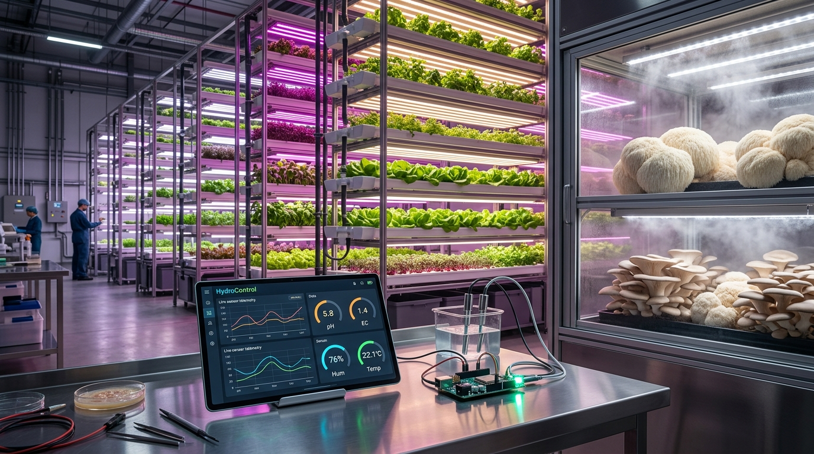

# 🌱 HydroControl - Système Intégral de Contrôle, IA et Télémétrie pour l'Hydroponie

<p align="center">
  🌍 <strong>Langue / Idioma / Language:</strong><br>
  <a href="README.md"></a>
  <a href="README.en.md"></a>
  <a href="README.fr.md"></a>
  <a href="README.pt.md"></a>
</p>

<p align="center">
  
</p>

<p align="center">
  <a href="https://github.com/luchoxiii/Hydroponia_Domotic"></a>
  <a href="https://github.com/luchoxiii"></a>
  <a href="LICENSE"></a>
  
  
  
  
  
  
  
  
  
  
  
  
</p>

<p align="center">
  🌐 <strong>Dépôt Officiel :</strong> <a href="https://github.com/luchoxiii/Hydroponia_Domotic">github.com/luchoxiii/Hydroponia_Domotic</a> &nbsp;|&nbsp; 👤 <strong>Auteur &amp; Titulaire des Droits :</strong> <a href="https://github.com/luchoxiii">luchoxiii</a>
</p>

---

## ⚙️ Comment Fonctionne le Système ?

**HydroControl** est une plateforme logicielle et matérielle ouverte conçue pour exploiter des serres commerciales, des fermes verticales et des installations domestiques d'hydroponie et de myciculture (culture de champignons). Elle coordonne en temps réel l'acquisition de télémétrie issue de microcontrôleurs (ESP32, Arduino, Raspberry Pi), évalue les paramètres vitaux des cultures par rapport à un catalogue botanique et mycologique de référence, exécute des diagnostics prédictifs avec le **Machine Learning (Random Forest)**, consigne chaque opération dans un **journal d'audit forensique chiffré AES-256 + HMAC**, et diffuse des alertes via **Telegram** et **Discord**.

---

## 🌟 Catalogue Complet des Fonctionnalités

### 1. 📚 Catalogue Botanique et Mycologique (Plantes et Champignons)
Inclut par défaut **15 espèces pré-calibrées** et permet d'ajouter des espèces personnalisées :
* **🌱 Plantes Hydroponiques** : Laitue Butterhead, Basilic, Tomate Cerise, Épinard, Fraise, Poivron, Coriandre, Menthe, Roquette, Chou Kale, Concombre.
* **🍄 Champignons Mycologiques** : Champignon de Paris, Pleurote en Huître (*Pleurotus ostreatus*), Shiitake, Hydne Hérisson / Crinière de Lion (*Hericium erinaceus*).
* **Paramètres Configurables** : pH min/max, Conductivité Électrique (EC en mS/cm), Température (°C), Humidité Relative (%), Photopériode (heures de lumière) et durée estimée du cycle (jours).

### 2. 🌿 Cycle de Vie et Gestion des Cultures Actives
* Suivi automatique des jours d'activité et barre de progression vers la récolte.
* Machine à états : `ACTIVO` (Actif), `PAUSADO` (En pause), `COSECHADO` (Récolté).
* **Suppression Sécurisée en Cascade (`POST /cultivos/<id>/eliminar`)** : Dissocie proprement les microcontrôleurs IoT (`cultivo_id = None`), supprime l'historique des capteurs et les alertes sous transaction ACID, et enregistre l'événement dans le journal chiffré.

### 3. 🧠 Centre d'Intelligence Artificielle et Laboratoire « What-If » (`/ml`)
* **Random Forest Classifier (100 arbres + `StandardScaler`)** : Entraîné sur 1 500 scénarios agronomiques équilibrés (**97,3 % d'exactitude**, **96,9 % de score F1**, latence d'inférence **< 2 ms** en mémoire RAM).
* **5 États de Diagnostic Physiologique** :
  * `OPTIMO` (Optimal / Sain)
  * `ESTRES_TERMICO` (Stress Thermique - Chaleur/Froid)
  * `ESTRES_HIDRICO` (Stress Hydrique / Réservoir bas)
  * `DESBALANCE_NUTRICIONAL` (Déséquilibre Nutritionnel / Blocage ionique)
  * `RIESGO_PATOGENO` (Risque Pathogène / Fongique)
* **Simulateur Interactif « What-If » (`POST /api/ml/simular`)** : Curseurs en temps réel et scénarios prédéfinis en 1 clic pour tester la réponse du modèle IA avant d'ajuster la serre.
* **Modèle Phénologique Thermique de Récolte (GDD - Degrés-Jours de Croissance)** : Calcule l'intégrale thermique $\text{GDD} = \sum \max(0, T_{\text{moy}} - T_{\text{base}})$ pour estimer les jours restants avant la récolte.

### 4. 🌦️ Intégration Bioclimatique Satellitaire (Open-Meteo)
* Interroge l'API météorologique **Open-Meteo** (sans clé API) avec cache mémoire de 10 minutes et mode de secours hors-ligne.
* Calcule les différentiels de température ($\Delta T$) et d'humidité ($\Delta H$) entre l'intérieur et l'extérieur pour recommander la ventilation ou l'humidification.

### 5. 📁 Importation et Exportation Massives en CSV
* Téléchargement instantané de l'historique en CSV (`/cultivos/<id>/exportar.csv` ou `/cultivos/<id>/exportar-csv`).
* Importation par lots supportant le **Format Large** et le **Format Long**, avec génération automatique d'alertes.

### 6. 🔌 Plateforme IoT et Générateur de Firmware en 1 Clic
* **Téléchargement Direct du Firmware Arduino/ESP32 (`.ino`)** : Code C++ pré-rempli avec l'`api_key`, l'URL du serveur et les identifiants Wi-Fi.
* **Simulateur de Capteur Virtuel en 1 Clic (`/dispositivos/simulador-virtual`)** : Permet d'injecter des lectures normales ou des anomalies critiques sans matériel physique.

### 7. 💬 Architecture Double de Notifications et Télémétrie
* **Bot 1 — Télémétrie Privée du Développeur (`services/telemetria_dev.py`)** : Canal privé rapportant l'UUID d'installation, l'OS, la version de Python, le nombre de démarrages et la consommation de ressources.
* **Bot 2 — Canaux de Notification de l'Utilisateur (`services/notificaciones_usuario.py` & `services/telegram_bot.py`)** : **Webhooks Discord** (Embeds enrichis) et **Bot Telegram Personnel** avec commandes interactives (`/start`, `/status`, `/cultivos`, `/telemetria <id>`, `/clima`, `/alertas`).

### 8. 🔒 Journal d'Audit Forensique Chiffré et Immuable (`/bitacora`)
* Chiffrement authentifié **Fernet (AES-128-CBC + HMAC-SHA256)** avec dérivation de clé **PBKDF2-HMAC-SHA256 (100 000 itérations)**.
* **Chaînage Cryptographique deHachage (SHA-256 Hash Chaining)** garantissant l'intégrité mathématique de chaque bloc.

### 9. 🌍 Support Multilingue Natif (Espagnol, Anglais, Français et Portugais)
* Moteur d'internationalisation intégré ([`services/i18n.py`](services/i18n.py)) prenant en charge **Espagnol (`es`)**, **Anglais (`en`)**, **Français (`fr`)** et **Portugais (`pt`)**.
* Sélecteur de langue dans la barre de navigation (`/idioma/<lang>` ou `/set-language/<lang>`), paramètre `?lang=fr`, cookie persistant (`hydro_lang`), détection automatique `Accept-Language` et API JSON (`/api/i18n/<lang>`).

---

## 🚀 Démarrage Rapide et Déploiement en Production

### Développement Local
```bash
python -m venv .venv
# Windows :
.venv\Scripts\activate
# Linux / macOS :
source .venv/bin/activate

pip install -r requirements.txt
python seed_demo.py
python app.py
```

### Serveur WSGI de Production (Waitress)
```bash
# Windows :
iniciar_produccion.bat
# Linux / Raspberry Pi :
./iniciar_produccion.sh
# Ou directement :
python wsgi.py
```

### Docker & Docker Compose
```bash
docker-compose up -d --build
```

### Suite de Tests Automatisés (Pytest)
```bash
pytest -v
```

---

## 👤 Auteur et Licence

* **Auteur** : **luchoxiii** ([@luchoxiii](https://github.com/luchoxiii))
* **Dépôt Officiel** : [https://github.com/luchoxiii/Hydroponia_Domotic](https://github.com/luchoxiii/Hydroponia_Domotic)
* **Licence** : Distribué sous la **Licence MIT**. Consultez le fichier [`LICENSE`](LICENSE) pour plus de détails.
