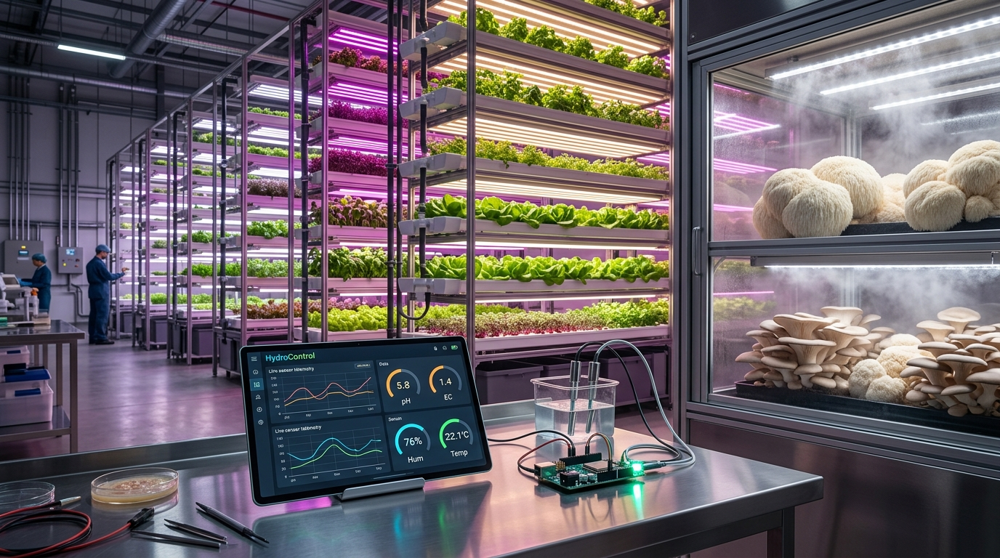

# 🌱 HydroControl - Sistema Integral de Controle, IA e Telemetria para Hidroponia

<p align="center">
  🌍 <strong>Idioma / Language / Langue:</strong><br>
  <a href="README.md"></a>
  <a href="README.en.md"></a>
  <a href="README.fr.md"></a>
  <a href="README.pt.md"></a>
</p>

<p align="center">
  
</p>

<p align="center">
  <a href="https://github.com/luchoxiii/Hydroponia_Domotic"></a>
  <a href="https://github.com/luchoxiii"></a>
  <a href="LICENSE"></a>
  
  
  
  
  
  
  
  
  
  
  
  
</p>

<p align="center">
  🌐 <strong>Repositório Oficial:</strong> <a href="https://github.com/luchoxiii/Hydroponia_Domotic">github.com/luchoxiii/Hydroponia_Domotic</a> &nbsp;|&nbsp; 👤 <strong>Autor &amp; Titular dos Direitos:</strong> <a href="https://github.com/luchoxiii">luchoxiii</a>
</p>

---

## ⚙️ Como Funciona o Sistema?

O **HydroControl** é uma plataforma aberta de software e hardware projetada para operar estufas comerciais, fazendas verticais e cultivos domésticos de hidroponia e fungicultura (cogumelos). Ele coordena em tempo real a ingestão de telemetria de microcontroladores (ESP32, Arduino, Raspberry Pi), avalia os sinais vitais do cultivo contra um catálogo botânico e micológico de referência, executa diagnósticos preditivos com **Machine Learning (Random Forest)**, registra todas as operações em um **livro-razão de auditoria forense criptografado com AES-256 + HMAC**, e envia alertas através de canais independentes no **Telegram** e **Discord**.

---

## 🌟 Catálogo Completo de Funcionalidades

### 1. 📚 Catálogo Botânico e Micológico (Plantas e Fungos)
Inclui de fábrica **15 espécies pré-calibradas** e permite cadastrar novas espécies personalizadas:
* **🌱 Plantas Hidropônicas**: Alface Butterhead, Manjericão, Tomate Cereja, Espinafre, Morango, Pimentão, Coentro, Hortelã, Rúcula, Couve Kale, Pepino.
* **🍄 Fungos Micológicos**: Champignon de Paris, Cogumelo Shimeji / Ostra (*Pleurotus ostreatus*), Shiitake, Juba de Leão (*Hericium erinaceus*).
* **Parâmetros Configuráveis por Espécie**: pH mín/máx, Condutividade Elétrica (EC em mS/cm), Temperatura (°C), Umidade Relativa (%), Fotoperíodo diário (horas de luz) e ciclo estimado até a colheita (dias).

### 2. 🌿 Ciclo de Vida e Gestão de Cultivos Ativos
* Cálculo dinâmico de dias ativos e barra de progresso percentual até a colheita.
* Máquina de estados: `ACTIVO` (Ativo), `PAUSADO` (Pausado), `COSECHADO` (Colhido).
* **Exclusão Segura em Cascata (`POST /cultivos/<id>/eliminar`)**: Desvincula os microcontroladores IoT associados (`cultivo_id = None`), remove leituras e alertas sob controle transacional ACID e registra o evento no log criptografado.

### 3. 🧠 Centro de Inteligência Artificial e Laboratório "What-If" (`/ml`)
* **Random Forest Classifier (100 árvores de decisão + `StandardScaler`)**: Treinado com 1.500 cenários agronômicos balanceados (**97,3% de acurácia**, **96,9% de F1-Score** e latência de inferência **< 2 ms** em memória RAM local).
* **5 Classes de Diagnóstico Fisiológico**:
  * `OPTIMO` (Ótimo / Saudável)
  * `ESTRES_TERMICO` (Estresse Térmico - Calor/Frio)
  * `ESTRES_HIDRICO` (Estresse Hídrico / Reservatório Baixo)
  * `DESBALANCE_NUTRICIONAL` (Desequilíbrio Nutricional / Bloqueio Iônico)
  * `RIESGO_PATOGENO` (Risco Patogênico / Fúngico)
* **Simulador Interativo "What-If" (`POST /api/ml/simular`)**: Controles deslizantes em tempo real e presets de 1 clique para simular variações químicas e microclimáticas antes de aplicá-las na estufa.
* **Modelo Fenológico Térmico de Colheita (GDD - Graus-Dia de Crescimento)**: Calcula o acúmulo térmico $\text{GDD} = \sum \max(0, T_{\text{média}} - T_{\text{base}})$ para projetar os dias restantes até a colheita.

### 4. 🌦️ Integração Bioclimática via Satélite (Open-Meteo)
* Consulta a API meteorológica **Open-Meteo** (sem necessidade de chave de API) com cache em memória de 10 minutos e estimador resiliente offline.
* Calcula os diferenciais térmico ($\Delta T$) e de umidade ($\Delta H$) entre o interior e o exterior para recomendar ventilação passiva, exaustão forçada ou umidificação ultrassônica.

### 5. 📁 Importação e Exportação em Massa via CSV
* Download instantâneo de todo o histórico em CSV (`/cultivos/<id>/exportar.csv` ou `/cultivos/<id>/exportar-csv`).
* Importação em lote compatível com **Formato Largo** e **Formato Longo**, com verificação automática de alertas.

### 6. 🔌 Plataforma IoT e Gerador de Firmware em 1 Clique
* **Download Direto de Firmware Arduino/ESP32 (`.ino`)**: Gera automaticamente o código C++ com a `api_key`, endereço IP/porta do servidor e credenciais Wi-Fi injetadas.
* **Simulador de Sensor Virtual em 1 Clique (`/dispositivos/simulador-virtual`)**: Injeta telemetria normal ou anomalias críticas para testar alertas e IA sem hardware físico conectado.

### 7. 💬 Arquitetura Dupla de Notificações e Telemetria
* **Bot 1 — Telemetria Privada do Desenvolvedor (`services/telemetria_dev.py`)**: Canal privado para o criador do software com UUID de instalação, SO, versão do Python, contagem de inicializações e consumo de recursos.
* **Bot 2 — Canais de Notificação do Usuário (`services/notificaciones_usuario.py` & `services/telegram_bot.py`)**: **Webhooks do Discord** (Embeds ricos) e **Bot Pessoal do Telegram** com comandos interativos (`/start`, `/status`, `/cultivos`, `/telemetria <id>`, `/clima`, `/alertas`).

### 8. 🔒 Registro de Auditoria Forense Criptografado e Imutável (`/bitacora`)
* Criptografia simétrica autenticada **Fernet (AES-128-CBC + HMAC-SHA256)** com derivação de chave **PBKDF2-HMAC-SHA256 (100.000 iterações)**.
* **Encadeamento Criptográfico de Hashes (SHA-256 Hash Chaining)** garantindo integridade contra qualquer tentativa de adulteração.

### 9. 🌍 Suporte Multilíngue Nativo (Espanhol, Inglês, Francês e Português)
* Motor de internacionalização integrado ([`services/i18n.py`](services/i18n.py)) com suporte para **Espanhol (`es`)**, **Inglês (`en`)**, **Francês (`fr`)** e **Português (`pt`)**.
* Seletor interativo na barra de navegação superior (`/idioma/<lang>` ou `/set-language/<lang>`), parâmetro `?lang=pt`, cookie persistente (`hydro_lang`), detecção automática via cabeçalho `Accept-Language` e endpoint JSON (`/api/i18n/<lang>`).

---

## 🚀 Início Rápido e Implantação em Produção

### Desenvolvimento Local
```bash
python -m venv .venv
# Windows:
.venv\Scripts\activate
# Linux / macOS:
source .venv/bin/activate

pip install -r requirements.txt
python seed_demo.py
python app.py
```

### Servidor WSGI de Produção (Waitress)
```bash
# Windows:
iniciar_produccion.bat
# Linux / Raspberry Pi:
./iniciar_produccion.sh
# Ou diretamente:
python wsgi.py
```

### Docker & Docker Compose
```bash
docker-compose up -d --build
```

### Suíte de Testes Automatizados (Pytest)
```bash
pytest -v
```

---

## 👤 Autor e Licença

* **Autor**: **luchoxiii** ([@luchoxiii](https://github.com/luchoxiii))
* **Repositório Oficial**: [https://github.com/luchoxiii/Hydroponia_Domotic](https://github.com/luchoxiii/Hydroponia_Domotic)
* **Licença**: Distribuído sob os termos da **Licença MIT**. Consulte o arquivo [`LICENSE`](LICENSE) para mais informações.
